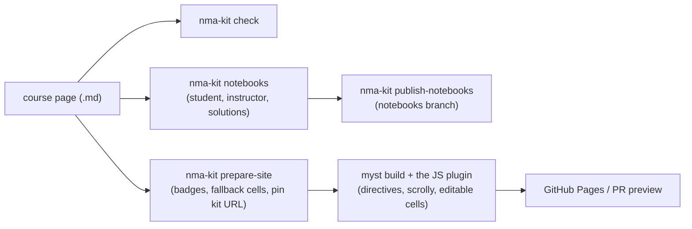

# Contributing

Thanks for helping. This repo is one project with one version and three
deliverables: a MyST plugin (`js/`), the `nma-kit` CLI (`python/`) and
reusable GitHub workflows (`.github/workflows/course-*.yml`). The
[README](README.md) is for course authors who *use* the kit; this file is for
people who change it. [AGENTS.md](AGENTS.md) is the detailed internals
reference (layout, rules, how each feature works).

## How it fits together



Each feature (`media`, `solutions`, `feedback`, `assets`, `scrolly`, `cells`)
has a JS half that renders the web page and a Python half that checks the
content and writes the notebooks. Both halves must agree; see
[Twins](#python-and-js-twins).

## Set up

You need [uv](https://docs.astral.sh/uv/), Node 22 and `make`.

```bash
make setup    # Python + JS dependencies and the pre-commit hook
make test     # lint, Python tests, JS tests (builds the bundle first)
make help     # every task
```

`make test` rebuilds the JS bundle because some JS tests read `js/dist/`,
which is gitignored and goes stale after a version bump or a `git pull`. If
you run `npm test` yourself and it complains about the `dist` version, run
`make build`.

Without `make`, the same steps are:

```bash
cd python && uv venv && uv pip install -e '.[test,dev]' -r ../tests/example-course/requirements.txt
uv run pytest -q ../tests/python
cd ../js && npm ci && npm run build && npm test && npm run build:dev && npm test
```

## Linting

`make lint` runs [ruff](https://docs.astral.sh/ruff/) (`ruff.toml`) on the
Python and [Biome](https://biomejs.dev) (`js/biome.json`) on the JS, and CI
runs the same. The pre-commit hook from `make setup` runs them on commit.
Neither tool formats code: match the style of the file you are in. Ruff also
requires a docstring on every public module, class and function.

## Test layers

| Layer | Command | Covers |
|---|---|---|
| Python unit | `make test-py` | CLI, conversion, checks, workflows, release consistency, twin registry |
| JS unit | `make test-js` | plugin logic, bundle contents, feature boundaries |
| Example course | `make example` | a real `myst build` with the dev bundle |
| Browser | `make e2e` prints the steps (details in [AGENTS.md](AGENTS.md)) | editable cells, branding, in Chromium (slow: each page boots Pyodide) |

CI runs all of them on pull requests. Run `make test` before you push.

## Python and JS twins

Some logic exists in both languages because the plugin runs in Node and the
CLI in Python (settings, page paths, URL and file naming, `{nma-data}`
parsing, scrolly cell keys, ...). Drift between the halves breaks courses
silently, so:

1. **Every twin is listed in [`tests/twins.json`](tests/twins.json)**: the
   symbol on each side, and the shared fixture under `tests/fixtures/` that
   pins its behaviour.
2. **`tests/python/test_twins.py` checks the registry**: each symbol still
   exists, a test on each side names it, and the fixture exists. Renaming or
   deleting a twin fails the test until the registry is updated.
3. **Test both sides against the same fixture.** Change a rule by changing
   the fixture first, then make both implementations pass.
4. If you write a new twin, add a registry entry and a fixture in the same PR.
5. **Prefer not to write a twin at all.** Values that are the same on both
   sides (defaults, the notebooks-branch env var, the embed limit, the
   no-fallback marker) live in
   [`python/src/nma_kit/constants.json`](python/src/nma_kit/constants.json).
   Python reads it (`nma_kit/constants.py`) and the JS bundle inlines it
   (`js/src/shared/constants.mjs`). Add shared values there, never in both.

## Adding or changing a feature

- Keep a feature in its own folder: `js/src/<feature>/` may import only from
  itself and `js/src/shared/` (enforced by `tests/js/structure.test.mjs`); the
  Python side uses the same name (`python/src/nma_kit/<feature>.py`).
- Register new directives in `js/src/<feature>/plugin.mjs` and list the plugin
  in `js/src/index.mjs` (the order matters, see the comment there).
- Browser code never uses root-absolute URLs; derive them from
  `import.meta.url` (courses are deployed under `github.io/<repo>/`).
- Colours are CSS variables, never fixed values (`--nma-brand-*`, `--sc-*`,
  `--nma-cell-*`).
- Add `nma-kit check` rules for anything an author can get wrong.
- Update, in the same PR: the tests, the docstrings and JSDoc, [README.md](README.md) if
  authors see the change, and [AGENTS.md](AGENTS.md) if the internals change.

## Documentation style

- **Every module opens with a docstring or comment** saying what it is for.
  **Every public function and class has a docstring or JSDoc** that says what
  it does, not how.
- Comments explain *why* (a constraint, a trap, a decision), not what the
  code says.
- The docs have one home each, so they don't drift:

  | Where | For |
  |---|---|
  | `README.md` | course authors: setup, settings, versions |
  | `python/README.md`, `js/README.md` | the PyPI and npm pages |
  | `CONTRIBUTING.md` | contributors: workflow, tests, conventions |
  | `AGENTS.md` | internals: layout, rules, how each feature works |
  | `docs/releasing.md` | maintainers: the release setup |
  | `CHANGELOG.md` | generated by release-please: don't edit |

- Design notes for a feature live in the PR description. Don't commit
  point-in-time specs or plans; they go stale. Durable decisions belong in the
  rules and internals of `AGENTS.md`.

## Workflows

`ci.yml` calls the same `make` targets you run locally (`lint`, `test-py`,
`test-js`), so a green `make test` means a green CI for those jobs. The
reusable course workflows (`course-*.yml`) cannot use `make`: a course has no
Makefile.

Those three workflows repeat the same setup steps (uv, Node, install the kit).
A shared composite action would remove that, but a reusable workflow cannot
pin it to its own release: a floating tag mixes versions, and an exact tag
doesn't exist yet on the release PR. Until that is solved,
`tests/python/test_workflow_setup.py` fails if the copies differ. Change all
three together.

## Commits and pull requests

- Use [conventional commits](https://www.conventionalcommits.org): `fix:` for
  a patch, `feat:` for a feature, `feat!:` (or a `BREAKING CHANGE:` footer) for
  a breaking change. release-please builds the changelog and the version
  from them, and while we are on 0.x a breaking change bumps the minor version.
- **Never edit version numbers by hand**; release-please does, in every file
  that states one (`tests/python/test_release.py` checks they agree).
- Branch from `main`; CI runs on pull requests and needs the branch up to date.
- Every PR gets a preview of the example course (`preview.yml`).

## Releasing

Maintainers only: [docs/releasing.md](docs/releasing.md). `make dist` builds the release
artifacts locally without publishing.
